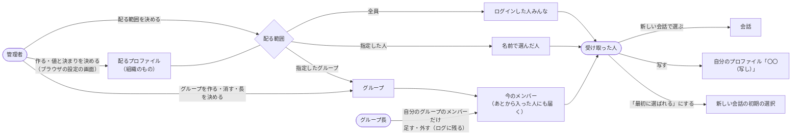
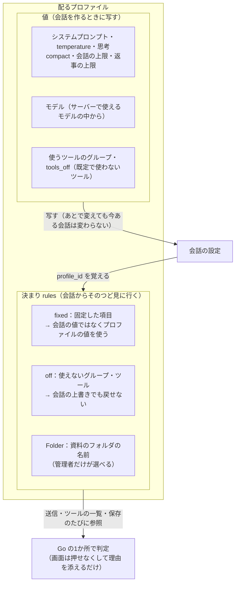
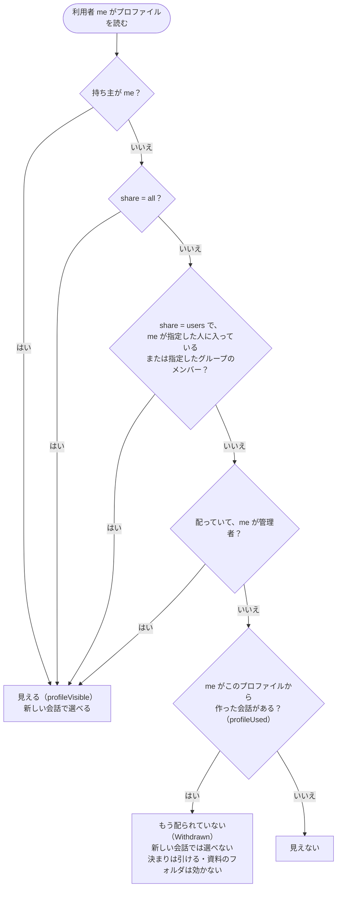
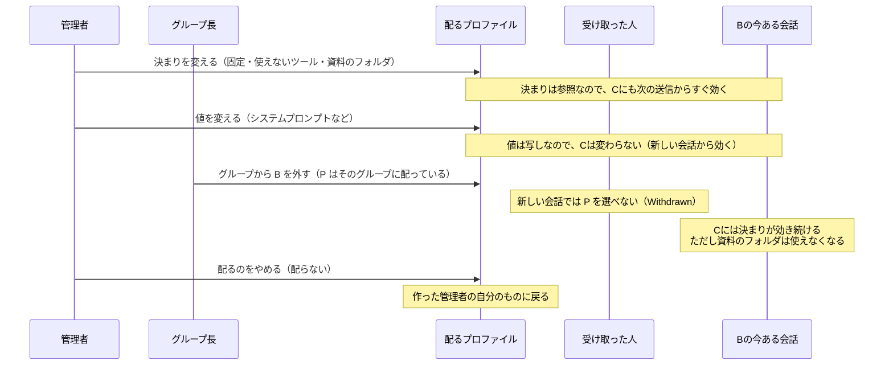
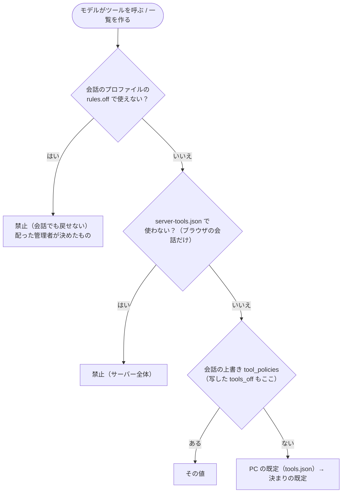
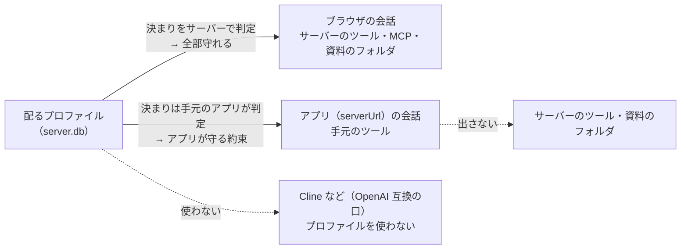
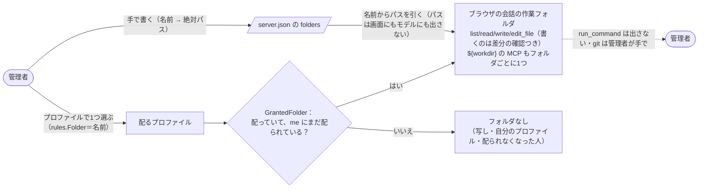

# aibow の「プロファイルを配る」の図(2026-11-01 時点)

元にしたもの:`_docs/features/0014-profiles.md`(プロファイルと決まり)・`0018-sharing.md`(配る・会話の共有)・`0024-server-tools.md`(サーバーのツールと資料のフォルダ)・`0031-users-ui.md`(グループとグループ長。コミット済み)、
コードは `store/profiles.go` の `profileVisible` / `profileUsed` / `profileEditable`・`rules.go` の `GrantedFolder`・`tools.go` の `policyOf`。
図は Mermaid。[architecture-diagrams.md](architecture-diagrams.md) の続き。

## 0. ひと目で

| | 自分のプロファイル | 配ったプロファイル | 配られたプロファイルの写し |
|---|---|---|---|
| 作る人 | だれでも(自分の分) | **管理者だけ**(ブラウザでログインしたとき) | 受け取った人 |
| 変えられる人 | 持ち主 | **管理者ならだれでも**(組織のもの) | 写した人 |
| 届く相手 | 自分だけ | 全員 / 指定した人 / 指定したグループ | 自分だけ |
| 決まり(固定・使えない) | 自分で自分にかける | 管理者が決め、受け取った人は変えられない | 写したときの決まりが出発点。写した人が外せる |
| 資料のフォルダ | 効かない | **効く**(まだ配られている人にだけ) | 写さない |

---

## 1. 誰が作り、誰に届くか

管理者が作って配る。グループに配ったときは「そのときのメンバー」ではなく「グループ」として覚えるので、**グループ長がメンバーを変えると、届く人も変わる**。

ポイント
- 配る相手を選ぶのは、会話の共有と同じ「人を選ぶ部品」(0031。人とグループを混ぜてよい。選んでから確定)
- 長は配る・プロファイルを変えることはできない。できるのはメンバーの出し入れだけ。だからこそ、足すときの確かめに「n 件のプロファイルを読めるようになります」と出る
- 配った管理者を消しても、配ったプロファイルは消えずに配り続ける(作った人の名前は残す)

---

## 2. プロファイルの中身:「写す」ものと「見に行く」もの

会話を作るとき、**値は写し、決まりはそのつどプロファイルを見に行く**(0014 の 6・7)。だから管理者があとで決まりを変えると、今ある会話にもすぐ効く。

---

## 3. 誰に見えるか(`store` の SQL の条件の1か所)

「見える(新しい会話で選べる)」と「決まりを引ける」は別の条件。配るのをやめても、その人がもう作った会話には決まりが効き続ける(0018 の 21)。

変えられるか(`profileEditable`)
- 配っていないもの:持ち主だけ
- 配っているもの:管理者ならだれでも(受け取った人には読むだけ)

---

## 4. 配ったあとに変えると、何が起きるか

---

## 5. ツールの扱いとのつながり

配るプロファイルの「使えない」(`rules.off`)は、`policyOf` のいちばん上に効く。
`server-tools.json` は**プロファイルとは別**の、aibow-server 全体の既定(管理者が設定の画面の「ツール」で決める)。

どこで守られるか(0018 の「守らせられる場所」)

---

## 6. 資料のフォルダとのつながり(0024 の 12-2)

フォルダは「プロファイルの決まり」に名前で持つ。だから**誰が使えるかは、配る相手でそのまま決まる**。

---

## 7. 会話の共有(0018)との違い

どちらも「人を選ぶ部品」と、同じ形の SQL の条件(`conversationShared` / `profileVisible`)を使うが、中身は別物。

| | 会話の共有 | プロファイルを配る |
|---|---|---|
| できる人 | だれでも(自分の会話) | 管理者だけ |
| 相手に渡るもの | 会話そのもの(ツールの結果も見える) | 作業の型(値と決まりと資料のフォルダ) |
| 相手ができること | 読むだけ。続けたいなら「写して続ける」 | 新しい会話で選ぶ・写して自分のプロファイルにする |
| あとから変えると | 共有をやめると見えなくなる | 決まりは今ある会話にも効く。値は新しい会話から |
| 範囲 | 非公開 / 指定した人・グループ / 全員 | 配らない / 指定した人・グループ / 全員 |
| 管理者 | 全員の会話を読める(読んだらログ) | 配ったものはどの管理者も変えられる |
