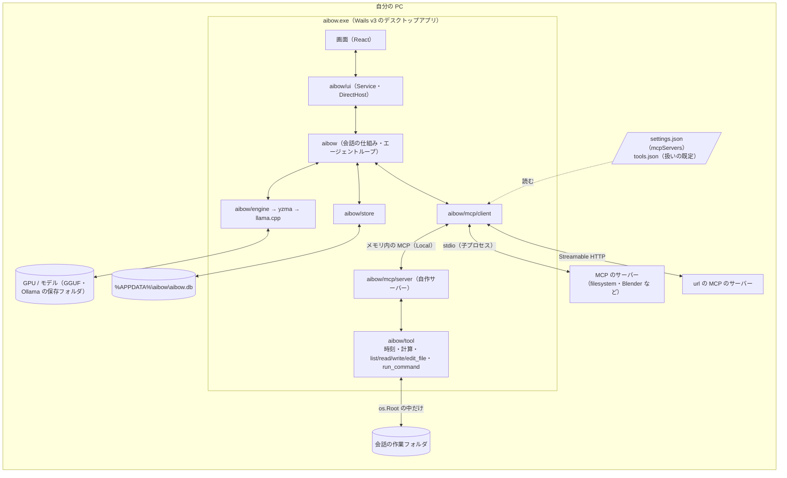
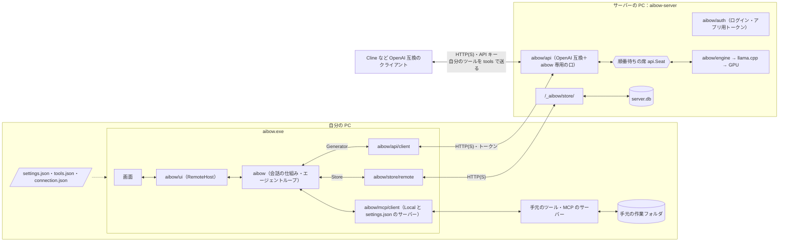
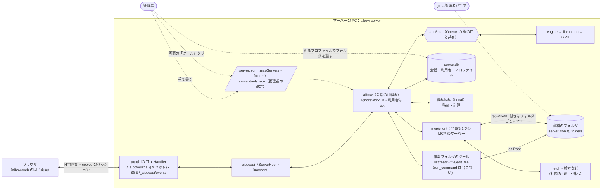
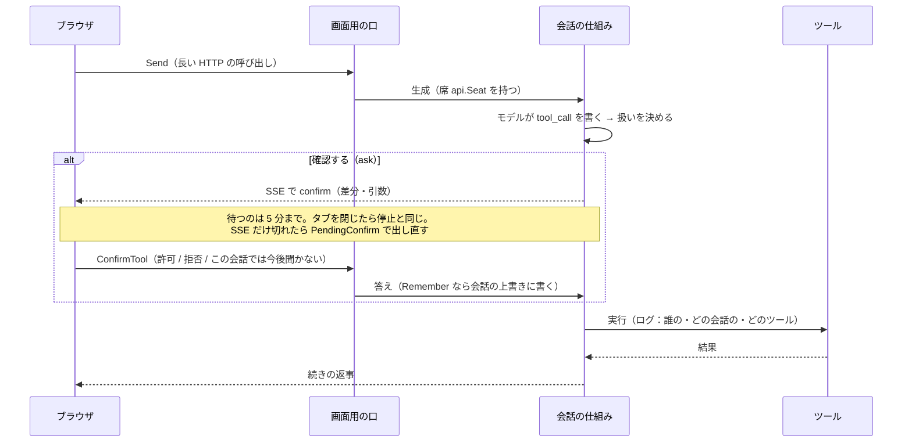
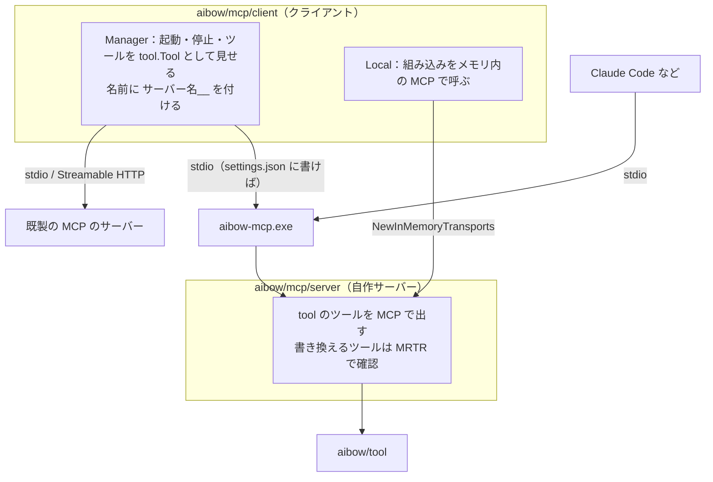
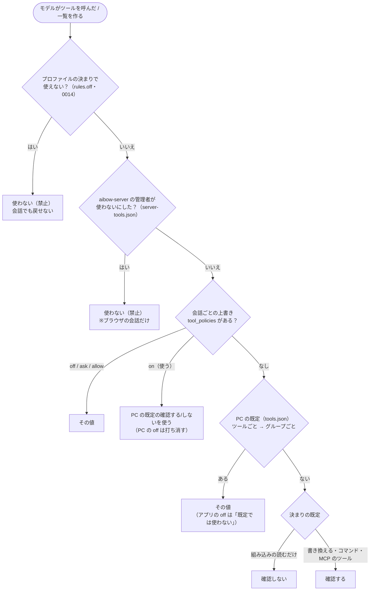
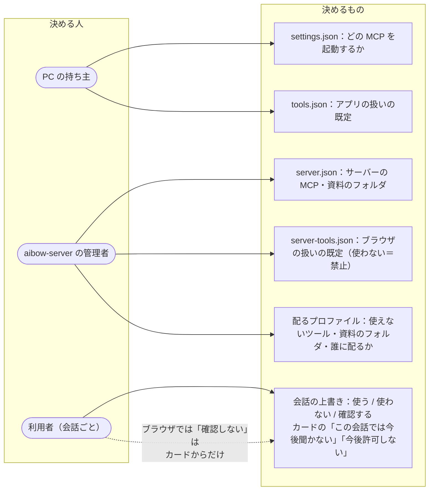

# aibow の構成と関係の図（2026-10-31 時点）

元にしたもの：`AGENTS.md`（全体の構成）・`_docs/mcp.md`・`_docs/features/0024-server-tools.md`・`tools.go` の `policyOf`。
図は Mermaid。aibow の返事の表示（mermaid の図）や GitHub でそのまま描ける。

## 0. ひと目で比べる

| | ① ローカルのアプリ | ② サーバーにつないだアプリ | ③ ブラウザ | （参考）Cline など |
|---|---|---|---|---|
| 生成（llama.cpp） | アプリの中 | aibow-server | aibow-server | aibow-server |
| 会話の保存 | 手元の `aibow.db` | `server.db` | `server.db` | クライアント側 |
| ツールが動く PC | 手元 | **手元** | **サーバー** | クライアント側（自分のツールを送る） |
| MCP のサーバーを書く所 | `settings.json` | `settings.json`（手元） | `server.json` の `mcpServers` | — |
| 扱いの既定 | `tools.json`（PC の人） | `tools.json`（PC の人） | `server-tools.json`（管理者） | — |
| 既定の「使わない」 | 既定では使わない（会話で使える） | 同左 | **禁止**（会話でも使えない） | — |
| 作業フォルダ | 会話ごとに手元のパス | 手元のパス | 管理者の「資料のフォルダ」（名前だけ見える） | — |
| `run_command` | あり（確認つき） | あり（確認つき） | **出さない** | — |
| 確認のカード | Wails の中で往復 | Wails の中で往復 | SSE で届き、画面用の口で答える | — |

---

## 1. ローカル利用のアプリ（いちばん小さい形）

ネットワークを使わず、1つのプロセスの中で全部が動く。組み込みのツールも、aibow の中で自作の MCP サーバーを立てて **メモリ内の MCP 越し** に呼ぶ（0007 の 5-4）。

ポイント
- 誰が決めるか：**その PC を使う人**（`settings.json` を手で書き、`tools.json` は画面で変える）
- `${workdir}` を使う MCP のサーバーは作業フォルダごとに1つ起動、使わないものは全会話で1つ
- サーバーは要る最初の送信のときに起動し、アプリを閉じるまで使う

---

## 2. サーバーありのアプリ（`connection.json` / `serverUrl` で aibow-server につなぐ）

生成と会話の保存だけがサーバーに移る。**ツールは今も手元の PC で動く**（0013 の C）。

ポイント
- アプリは llama.cpp を読み込まない。会話は `server.db` に置かれ、誰のものかは `ctx`（`aibow.WithUser`）で運ぶ
- サーバーの MCP や資料のフォルダは **アプリにも Cline にも出さない**（0024 の決定事項 13）

---

## 3. ブラウザでのツール（ステップ 9〜12）

会話の仕組みもツールも **サーバーの PC で動く**。決めるのは **管理者**。

確認の往復（12-1a）：今は Wails の中で済んでいる「ループを止めてカードを出し、答えを待つ」を、SSE と HTTP に分けたもの。

---

## 4. MCP 周り：つなぎ方・権限・ルール

### 4-1. aibow はクライアントでもサーバーでもある

### 4-2. ツールの扱いが決まる順番（`policyOf`。上から見て最初に決まったもの）

### 4-3. 誰が何を決められるか

信頼のルール（要点）
- MCP のツールは中身が見えないので、決まりの既定は **確認する**。`readOnlyHint` は信じない（0007 の決定事項 9）
- `settings.json` に書いた MCP のサーバーは、名乗りを偽れるので **呼ぶ前の確認も残す**（aibow-mcp でも確認が 2 回出る）。aibow の中の自作サーバー（Local）だけ、サーバーの差分を信頼して確認を 1 回にする
- ブラウザの会話では、サーバーの MCP は全員で1つ。人をまたいで状態が残らないものを置く・fetch が社内の URL に届く危うさは管理者が判断（aibow は止めない）
- ツールの実行はログに残す（確認しないで実行したもの・資料のフォルダに書いたものは Notice）

---

プロファイルを配る流れ(誰に届くか・決まり・資料のフォルダ・グループ長)の図は [diagrams-profiles.md](diagrams-profiles.md)。
